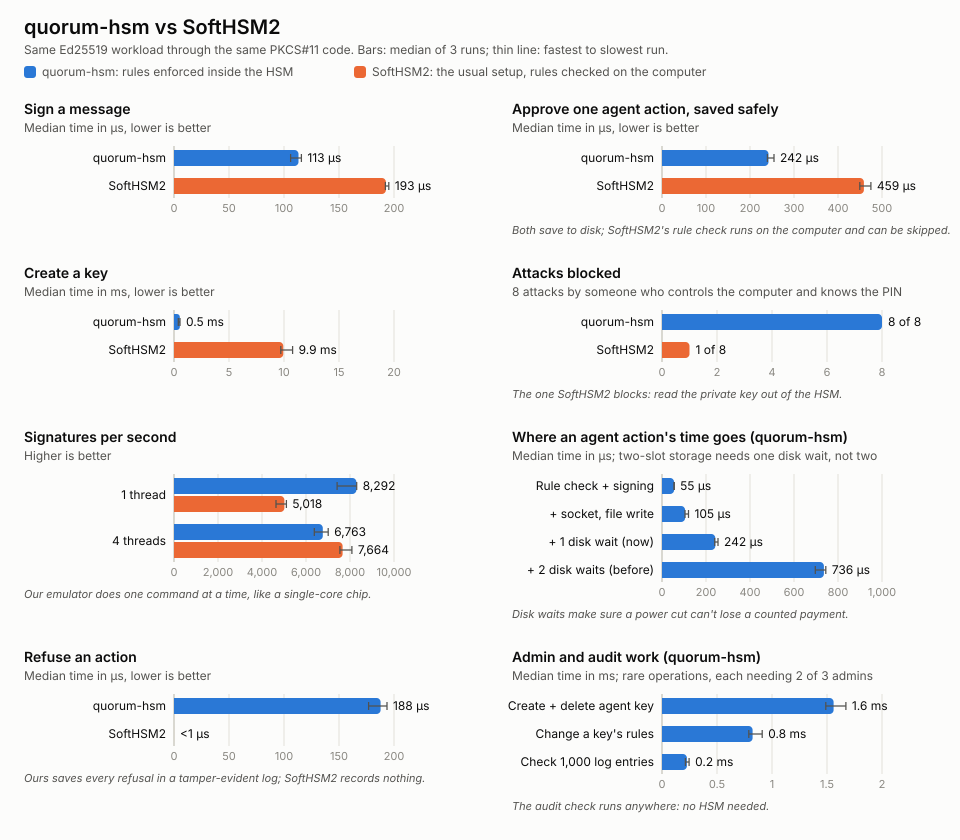

# agent-device-security

**A security chip, written in Rust, that guards the secret keys an AI agent uses, and that can't be tricked into misusing them.**

## The idea in one minute

When an AI agent on your phone or laptop does something important (sends an
email, makes a payment, installs an update), it proves the action is genuine
with a **digital signature**. A signature is made with a **secret key**. Whoever
steals that key can pretend to be your device.

So secret keys are kept in a special locked box called an **HSM** (Hardware
Security Module). Think of a notary with an official stamp locked in a safe:

- You never get the stamp. You hand over a document, and it comes back stamped.
- The stamp can't be copied out of the safe.

The weak spot: a normal HSM stamps **anything** the computer in front of it
asks for. If that computer is hacked, the attacker just asks the notary to stamp
their documents.

**This project builds a notary that checks the rules itself**, inside the safe.
Give an AI agent a key with rules like "payments only, at most $50 each, $200
in total, and anything over $20 needs my OK on my phone". The HSM enforces
those rules itself. A hacked computer or a misbehaving agent can't talk it out
of them.

**Does it work, and what does it cost?** We benchmarked it against SoftHSM2, the
standard open-source HSM, used the conventional way, with the rules checked on
the computer. We also ran eight attacks against both. **Ours blocked 8 of 8; the
conventional setup blocked 1.** A fully checked, double-checked, logged and
safely saved agent action takes about a quarter of a millisecond. Details in
[Benchmarks](#benchmarks).

## What works today

### Milestone 4: attacking it on purpose ✅

- **Glitch resistance.** Attackers with the device in hand can disturb a
  chip's power or clock to flip a single decision, like "over budget"
  becoming "fine". Now every decision that leads to a signature, a login or
  an admin change is made **twice, by separate code**. If the two disagree,
  the HSM records a "fault detected" entry and stops. A test-only switch
  flips each of the 9 decisions in turn, to prove one glitch never gets a
  signature through.
- **Disk failures at every moment.** A test runs a whole scenario and makes
  the disk fail at each save in turn. The HSM always stops cleanly, restarts
  from what was saved, and never handed out a signature it hadn't saved the
  spending for.
- **Fuzzing.** The fuzzer feeds the HSM millions of random and mutated
  inputs, and checks rules that must always hold. One target plays whole
  random sessions (logins, admin requests with forged approvals, tampered
  confirmations, garbage) and checks after every step that:
  - every approved action obeyed its key's rules
  - the saved state reloads
  - the audit log still verifies
- **The fuzzer found a real bug within seconds.** Saved state with junk
  hidden in a label's padding was accepted. It's fixed, and that input is
  kept as a permanent test.
- **A threat model** ([`docs/THREAT_MODEL.md`](docs/THREAT_MODEL.md)): what
  we protect, from whom, the 21 threats we handle, the test that proves each
  one, and what isn't covered yet.

### Milestone 3: changing things safely, and a record nobody can quietly edit ✅

- **Rules can change, but only with sign-off.** Admins can tighten or loosen
  an agent key's rules using the same "2 of 3 must agree" process. Money
  already spent still counts, so changing the rules can't reset a budget.
  The HSM issues a new birth certificate with a higher version number.
  Every signed action carries a fingerprint of the rules it was approved
  under, so a shop holding an old certificate notices the change.
- **Admins can be replaced.** When someone leaves, the *current* admins
  approve the new list. Would-be admins can't install themselves, and the
  list can never be emptied.
- **A tamper-evident audit log, kept by the HSM itself.** Every important
  event is recorded:
  - logins and wrong PINs
  - keys created and deleted
  - rule and admin changes
  - every agent action, **approved or refused**, with the reason
  - admin requests that were turned down

  Each entry is chained to the one before it, and the HSM signs
  "checkpoints" of the chain. Change one entry, delete it, or reorder two,
  and the check fails.
- **Nothing goes unrecorded.** The HSM holds up to 64 entries until an
  *audit collector* copies them out. If nobody does, the HSM stops working
  rather than lose evidence.
- **Refusals are saved too.** A refused action is written to the log before
  the HSM answers "no". That costs a disk write, but there's no way to make
  attempts that leave no trace.

```
 entry 1 ──► entry 2 ──► entry 3 ──► … ──► entry 38
 (factory)   (login)     (key made)        (admins replaced)
     each arrow = a hash of everything before it
                                            ▲
             HSM-signed checkpoint: "up to 38, the chain ends in 9f3a…"
```

### Who can create agent keys, and how receivers know they're genuine ✅

- **No single person can create or delete an agent key.** At the factory, the
  HSM is given a list of admins and a rule like "any 2 of these 3 must agree".
  To create a key, an operator starts a *proposal*. Each admin's tool shows
  them the exact rules in plain English, and they sign only if they agree.
  The HSM checks the signatures itself. Knowing the PIN isn't enough, and an
  approval for a $100 budget can't be reused for a $1,000,000 one.
- **Every agent key gets a birth certificate.** The HSM has its own identity
  key, made at the factory, that signs nothing but certificates: "key 1, with
  exactly these rules, was created on this HSM with approval from admins
  Alice and Bob." A shop only needs to trust the HSM's identity once; after
  that it can check any agent key and know the rules it's bound by.
- **Shops can stop replays and stale payments.** The shop hands the agent a
  payment request: a random one-time code plus a "valid until" time. The HSM
  signs both into the approval, and a key's rules can *require* one. The shop
  accepts each code once and refuses anything after it expires.

```
The shop trusts:  HSM identity
                       │  signed
                       ▼
                  birth certificate ── "key 1 has these rules, approved by Alice + Bob"
                       │  names
                       ▼
                  agent key 1
                       │  signed
                       ▼
                  approved action ──── "pay $15 to coffee-shop.example, for request 3ebb…"
                       │  must match
                       ▼
                  the shop's own request (right code, not expired, first use)
```

### Milestone 2: rules for AI agents ✅

- **Agent keys** come with rules that are fixed when the key is created:
  - which kinds of action are allowed (payments, messages, installing apps…)
  - the most a single payment can be
  - a total spending budget
  - which actions need the user's OK
- The agent doesn't hand the HSM a blob of bytes to sign. It describes the
  action ("pay $15 to coffee-shop.example"). The HSM **reads it, checks it
  against the rules, and writes and signs the statement itself**. So what gets
  signed is always exactly what was checked.
- **The user's OK is real.** The user's phone (simulated here) has its own key.
  To approve, it signs a one-time code from the HSM together with the exact
  action. An old approval can't be reused, and an approval for $30 to the
  airline can't be moved to $49 to someone else.
- **Anyone can check a signed action** without the HSM: who approved it, what
  exactly, whether the user confirmed, and its number in sequence (so replays
  and gaps are visible).
- The HSM **records the spending before it signs**, so a crash or power cut can
  never produce a signature that wasn't counted.

```
Agent: "pay $35 to airline.example"
   │
   ▼
HSM checks, in order:  allowed kind? → under the per-payment limit? →
                       within budget? → user's OK needed? Is it genuine?
   │
   ├─ any "no"  → DENIED (nothing signed, nothing charged)
   └─ all "yes" → record spending → sign the statement → APPROVED
```

### Milestone 1: a working HSM ✅

- You can create signing keys inside the HSM. The secret half can never be read out.
- You can sign messages, but only after logging in with the right PIN.
- After 5 wrong PINs, the HSM locks itself.
- It speaks **PKCS#11**, the standard language for HSMs, so existing tools
  (like `pkcs11-tool`) work with it out of the box.
- Signatures check out with OpenSSL, separate software that shares no code with this project.
- The core code builds for a real $5 microcontroller chip (Raspberry Pi RP2350),
  not just for a PC.
- Tested many ways: see [How it's tested](#how-its-tested).

## Try it

You need [Rust](https://rustup.rs), `pkcs11-tool` and `openssl`
(on Ubuntu: `sudo apt install opensc openssl`).

```bash
./scripts/demo-agent.sh  # an AI shopping agent: admins, rules, shops, attacks
./scripts/demo.sh        # the basics: keys, PIN and signing
./scripts/bench.sh       # speed and attack comparison with SoftHSM2
cargo test --workspace   # run all the tests
```

**The agent demo** sets up an HSM with three admins (any two must agree). It
gives a shopping agent a key with these rules:

- payments and messages only
- at most $50 each, $60 in total
- the user's OK for anything over $20
- every payment must answer a shop's request

Then it plays this out:

| What happens | Result |
|---|---|
| someone with the PIN and one admin tries to create the key | ❌ needs 2 of 3 admins |
| Alice and Bob review the rules and approve | ✅ key created, with a birth certificate |
| the agent buys a $15 coffee for the shop's request | ✅ approved; the shop checks identity → certificate → action → its request |
| someone sends the same signed payment to the shop again | ❌ the shop sees the request was already paid |
| the agent tries to pay without a shop's request | ❌ the rules require one |
| the agent books a $35 flight on its own | ❌ needs the user's OK |
| …after the user approves on their phone | ✅ approved, marked "confirmed by the user" |
| a payment arrives after the shop's request expired | ❌ the shop refuses it |
| the agent tries $80, deleting photos, or going over budget | ❌ refused by the HSM each time |
| (attacker with the PIN) signs raw bytes, or deletes the key | ❌ refused |
| (attacker) edits a signed action afterwards | ❌ the check fails |
| an audit collector copies the HSM's log out | ✅ entries saved to a file |
| the rules change to $10 per payment, $100 total, with only Alice's approval | ❌ needs 2 of 3 |
| …with Alice and Carol approving | ✅ new certificate (version 2); the $55 already spent still counts |
| a shop holding the old certificate checks a new payment | ❌ it notices the rules changed |
| Bob leaves and Dave joins (Alice and Bob approve) | ✅ admins replaced |
| Bob tries to approve something afterwards | ❌ he's no longer an admin |
| the log is checked against an HSM-signed checkpoint | ✅ complete and unaltered |
| someone erases the amount of the refused $80 attempt in the log | ❌ detected |
| someone deletes that entry instead | ❌ detected |

**The basics demo** creates an HSM, makes a key, signs a message, checks the
signature with OpenSSL, shows that a changed message fails, and shows a wrong
PIN being refused.

<details>
<summary>Doing it by hand</summary>

```bash
cargo build --release
export QUORUM_HSM_SOCKET=/tmp/quorum-hsm.sock
Q=target/release/quorum
MODULE=$PWD/target/release/libquorum_pkcs11.so

# Admins, then create and start an HSM where 2 of 3 must agree
for who in alice bob carol; do $Q admin new --out $who; done
target/release/quorum-emulator init --state hsm.state --pin 123456 \
  --admin alice.pub --admin bob.pub --admin carol.pub --threshold 2
target/release/quorum-emulator serve --state hsm.state --socket $QUORUM_HSM_SOCKET &
$Q identity --out hsm.id              # what shops need to trust

# Make a key, then sign a file with it
pkcs11-tool --module $MODULE --login --pin 123456 \
  --keypairgen --key-type EC:edwards25519 --label my-key --id 01
pkcs11-tool --module $MODULE --login --pin 123456 \
  --sign -m EDDSA --id 01 -i message.txt -o message.sig

# An agent key: propose, two admins approve, submit
$Q confirmer new --out phone
$Q admin propose-create --pin 123456 --label shopper --allow payment \
  --max-amount 50 --budget 200 --confirm-above 20 --confirmer phone.pub \
  --require-request --out proposal
$Q admin approve --proposal proposal --as alice --out ok.alice   # shows the rules, asks y/N
$Q admin approve --proposal proposal --as bob   --out ok.bob
$Q admin submit --pin 123456 --proposal proposal \
  --approval ok.alice --approval ok.bob --cert-out shopper

# The shop makes a request, the agent pays it, the shop checks
$Q shop request --out order.req
$Q act --pin 123456 --key 2 --kind payment --to shop.example --amount 35 \
  --request order.req --confirm-with phone --out paid    # phone asks y/N
$Q verify --hsm-identity hsm.id --cert shopper --signed paid --request order.req
$Q agent-key show --key 2              # rules, money spent, budget left

# Change the rules (two admins again); the new certificate replaces the old
$Q admin propose-update --pin 123456 --key 2 --allow payment --max-amount 10 \
  --budget 100 --require-request --out change
$Q admin approve --proposal change --as alice --out c.alice
$Q admin approve --proposal change --as carol --out c.carol
$Q admin submit --pin 123456 --proposal change --approval c.alice --approval c.carol \
  --cert-out shopper-v2

# The audit log: copy it out, get a signed checkpoint, check it, read it
$Q audit pull --log audit.log          # run this regularly; no PIN needed
$Q audit checkpoint --out checkpoint
$Q audit verify --hsm-identity hsm.id --log audit.log --checkpoint checkpoint
$Q audit show --log audit.log
```
</details>

## How it's tested

| Kind | What it proves | Run it |
|---|---|---|
| Unit and scenario tests (80) | Every rule, refusal and attack scenario behaves as designed | `cargo test --workspace` |
| Glitch tests (6 more) | Flipping any one security decision never yields a signature, login or key | `cargo test -p quorum-core --features fault-injection` |
| Disk-failure test | Failing the disk at every possible save never yields an unsaved signature | (part of the unit tests) |
| Power-cut test | A save cut off at any byte leaves the previous state intact | (part of the unit tests) |
| Fuzzing (5 targets) | Millions of random inputs: no crashes, one encoding per message, rules always hold | `./scripts/fuzz.sh 60` |
| Benchmark attacks (8) | Real attacks against our HSM and SoftHSM2; fails if any gets through ours | `./scripts/bench.sh` |
| Demos | The full stories, end to end, with real tools (`pkcs11-tool`, OpenSSL) | `./scripts/demo-agent.sh` |

All of these run on every push in GitHub Actions.

## How the pieces fit together

```
 Any program               Adapter                    The "chip"
 (pkcs11-tool,   ──────►   quorum-pkcs11   ──┐
  OpenSSL, …)    PKCS#11   translates only   │
                                             ├─►  quorum-emulator
 AI agent        ──────►   quorum (CLI)    ──┘     └─ quorum-core
 user's phone              asks, shows,   socket      makes every decision:
 verifier                  checks                     keys, PIN, signing,
                                                      agent rules
```

| Folder | What it is | Plain-English role |
|---|---|---|
| `crates/core` | `quorum-core` | The brain of the HSM. All security decisions happen here. |
| `crates/emulator` | `quorum-emulator` | Pretends to be the chip, so we can develop on a normal computer. |
| `crates/pkcs11` | `quorum-pkcs11` | The adapter that lets standard tools talk to our HSM. |
| `crates/cli` | `quorum` | The command-line tool: admins, agent actions, shops, the audit log. |
| `crates/client` | `quorum-client` | The small piece that connects programs to the HSM. |
| `crates/bench` | `quorum-bench` | Measures speed and runs attacks, against our HSM and SoftHSM2. |
| `fuzz/` | Fuzz targets | Random-input testing (needs a nightly compiler). |
| `scripts/demo-agent.sh` | Demo | The AI-agent story with one command. |
| `scripts/demo.sh` | Demo | The basics with one command. |
| `tools/` | Helpers | A code generator for the adapter, and the chart drawer. |
| `docs/BENCHMARKS.md` | Report | Benchmark results and what they mean. |
| `docs/THREAT_MODEL.md` | Report | What we protect, from whom, and how we know it works. |
| `docs/IDEAS.md` | Roadmap | Where the project is going. |

## Security choices, explained simply

| What we do | Why it matters |
|---|---|
| **Secret keys never leave the core.** There is no command that returns one. | Even a fully hacked computer can only ask for signatures, never steal the key. |
| **A wrong-PIN attempt is saved *before* the PIN is checked.** | An attacker can't cut the power at the right moment to get unlimited guesses. |
| **The PIN check takes the same time whether you're close or way off.** | Timing can't leak how many digits were right. |
| **If saving fails, the HSM stops working** until it restarts. | It would rather refuse than continue in an unknown state ("fail closed"). |
| **State is saved in two alternating slots, each with a hash.** | A power cut mid-save leaves the previous state intact; a test cuts a save off at every byte to prove it. |
| **Every security decision is made twice, by separate code.** | One hardware glitch can't turn a "no" into a signature; a mismatch stops the HSM. |
| **Saved state must have exactly one valid form** (no junk in padding). | Tampered or corrupted state is refused instead of half-trusted. Found by fuzzing. |
| **Deleted key numbers are never reused.** | An old reference can't accidentally point at a new key. |
| **The core is written without `unsafe` code** and without needing an operating system. | Rust checks it for whole classes of memory bugs, and it can run on a tiny chip. |
| **Every message from outside is checked strictly**: exact lengths, no extra bytes. | Malformed input is rejected instead of guessed at. |
| **Keys can't be created as "extractable".** | You can't ask the HSM to make a key that's allowed to leave. |
| **Agent keys never sign bytes the computer chose.** The HSM writes the statement itself. | Otherwise a hacked computer could skip the rules by asking for a "raw" signature. |
| **An agent key's rules change only with admin sign-off**, and money already spent still counts. | Nobody with just the PIN can loosen them, and a rule change can't reset a budget. |
| **Spending is saved before signing.** | Cutting the power at the right moment can't get a free, uncounted signature. |
| **The user's approval covers a one-time code and the exact action.** | Approvals can't be replayed or moved to a different action. |
| **Recipients and details must be plain printable text.** | No hidden characters or look-alike letters that make the phone show one thing while something else gets signed. |
| **Every signed action carries a sequence number and a fingerprint of the rules.** | A verifier can spot replays and missing actions, and knows which rules approved it. |
| **Creating or deleting an agent key needs several admins**, each signing the exact operation for this HSM, once. | One stolen password or one rogue admin can't make a key with loose rules, or delete one to get a fresh budget. |
| **Each admin approval covers a one-time code from the HSM**, which a restart cancels. | Old approvals can't be replayed later. |
| **The HSM's identity key signs only birth certificates and audit checkpoints**, each labelled with its purpose. | It can't be tricked into signing anything the computer chooses, so its signatures always mean what they say. |
| **Every important event goes into a hash-chained audit log, refusals included.** | Editing, deleting or reordering entries breaks the chain against an HSM-signed checkpoint. |
| **If the log is full, the HSM stops working** until it's copied out. | Nothing can happen without being recorded. |
| **Only logged-in users' actions are logged**, and failed PINs are capped at 5. | Someone without the PIN can't flood the log to stop the HSM. |
| **Admin changes need the *current* admins.** The list can never be emptied. | Nobody can appoint themselves, and there's always someone who can approve changes. |
| **Shops' one-time codes must be 16+ random bytes**, and the user's approval covers the code and expiry too. | Codes can't be guessed, and an agent can't stretch the deadline after the user said yes. |
| **Public keys from outside are checked strictly.** The test suite caught that the signature library accepts some malformed keys, so we added our own check. | A malformed or "weak" admin or phone key can't slip in. |

## Not done yet (honest limitations)

- The emulator is software pretending to be hardware. It is **not** real
  hardware protection yet: no protection against reading keys out of the
  chip, or against power-analysis attacks.
- The double checks handle **one** glitch per operation; several coordinated
  glitches need hardware sensors.
- The HSM's saved state file (keys and PIN) is **not encrypted** yet. Encrypting
  it with a key unique to each device is on the roadmap.
- The audit log makes deletion *detectable*, not impossible. If the only
  copy of the log is destroyed, the evidence is gone; keep copies somewhere
  the agent's computer can't reach.
- Ordinary (non-agent) key signatures aren't logged; only agent activity,
  key and admin changes, and logins are.
- Refused actions cost a disk write (about as much as an approved one).
  Someone with the PIN could use that to slow the HSM down.
- Deleting an agent key doesn't cancel its birth certificate everywhere.
  Shops have no way yet to learn that a key was retired ("revocation").
- Only one admin proposal can be in progress at a time.
- In real life the HSM's identity would itself be certified by the
  manufacturer. Here, shops are simply given it.
- The user's "phone" is simulated by a key file and a yes/no prompt. On a
  real device it would be a secure chip with its own screen and button.
- The HSM has no trusted clock, so budgets are lifetime totals, not "per day".
- Agent actions use the `quorum` tool, not PKCS#11. Agent keys show up in
  PKCS#11 but refuse to sign there.

## Roadmap

| # | Milestone | Status |
|---|---|---|
| 1 | Working HSM: keys, PIN, signing, PKCS#11, tests | ✅ Done |
| 2 | Rules inside the HSM for agent actions (limits, budget, user confirmation) | ✅ Done |
| 3 | Sign-off from several admins for key creation, deletion, rule changes and admin changes; birth certificates; tamper-evident audit log | ✅ Done |
| 4 | Fuzzing, glitch (fault-injection) tests, disk-failure tests, threat model | ✅ Done |
| 5 | **Run on a real chip (Raspberry Pi RP2350) with secure boot** | Next |

More detail in [`docs/IDEAS.md`](docs/IDEAS.md).

## Benchmarks

`./scripts/bench.sh` runs the same workload against our HSM and against
**SoftHSM2** (the standard open-source software HSM) through the same
PKCS#11 code. It measures speed, then **actually runs eight attacks** against
each. The full report, with what the numbers mean, is in
[`docs/BENCHMARKS.md`](docs/BENCHMARKS.md).



| | quorum-hsm (rules inside the HSM) | SoftHSM2 (rules on the computer) |
|---|---|---|
| Attacks blocked | **8 of 8** | 1 of 8 |
| Sign a message | ~115 µs | ~195 µs |
| Approve an agent action, saved safely | **~0.24 ms** | ~0.44 ms (and an attacker can skip the rules) |
| Refuse an action | ~0.18 ms (recorded in the audit log) | <1 µs (nothing recorded) |
| Change a key's rules (2 of 3 admins) | ~0.9 ms | not possible |
| Create a key | ~0.5 ms | ~12 ms |

**What we learned:**

- **The rules are almost free** (about 20 µs, audit entry included). The
  real cost is saving to disk safely, so a power cut can't give away a free
  signature.
- **Two-slot storage made safe saving 2.7× faster.** Each save now
  overwrites the older of two fixed slots and waits for the disk once,
  instead of writing a new file and renaming it (two waits). A test cuts a
  save off at every byte to prove a power cut can never corrupt the state.
- A refusal is saved before the HSM answers. That costs a disk write, and
  it's the price of leaving no untraceable attempts.
- Glitch double-checks cost nothing measurable on ordinary actions; actions
  and admin changes that carry extra signatures pay ~30–150 µs to check them twice.
- SoftHSM2 handles many requests at once better than our emulator does.

Fixed-function HSMs, like most cloud HSMs and YubiHSM 2, can't run custom
rules inside. The production path is programmable secure hardware: a TEE, a
secure microcontroller, or a commercial HSM with a firmware SDK.

## Glossary

- **HSM**: a locked box (hardware) that keeps secret keys and uses them without revealing them.
- **Key pair**: a secret *private key* that makes signatures, and a *public key* anyone can use to check them.
- **Signature**: proof that a message came from the key holder and wasn't changed.
- **Ed25519**: the modern, fast signature method this project uses.
- **PKCS#11**: the standard way programs talk to HSMs, like USB for security hardware.
- **PIN**: the password that unlocks signing. Too many wrong tries lock the HSM.
- **Emulator**: software that acts like a hardware device, for development.
- **`no_std`**: Rust code that needs no operating system, so it can run on tiny chips.
- **Agent key**: a key that only signs actions its rules allow.
- **Policy / rules**: what an agent key may do: kinds of action, limits, budget, when to ask the user.
- **Statement**: the HSM's signed record of exactly what it approved.
- **Confirmation device**: the user's phone, holding a key that proves "yes, I approve this".
- **Challenge**: a random one-time code from the HSM, so each approval can only be used once.
- **Verifier / receiver**: whoever receives a signed action and checks it (a shop, a server, an app store).
- **Admin**: a person whose sign-off is needed to create or delete agent keys.
- **Quorum / sign-off**: "enough admins agreed", e.g. 2 of 3.
- **Proposal**: the exact operation admins are asked to approve, tied to one HSM and a one-time code.
- **HSM identity**: the HSM's own key, made at the factory. It only signs birth certificates.
- **Birth certificate**: the HSM's signed statement that a key exists with exactly these rules, approved by these admins.
- **Payment request / one-time code (nonce)**: a random code from the shop, so each payment can be accepted only once.
- **fsync**: asking the disk to confirm data is really saved, not just queued. Slow but safe.
- **Benchmark**: a repeatable speed test.
- **Audit log**: the HSM's record of every important event, approved or refused.
- **Hash chain**: each entry includes a fingerprint of everything before it, so changing anything earlier changes every later fingerprint.
- **Checkpoint**: the HSM's signed statement "the log up to entry N ends in this fingerprint".
- **Audit collector**: a program that regularly copies the log out of the HSM and keeps it safe.
- **Rules version**: goes up by one each time admins change an agent key's rules; shown on its birth certificate.
- **Two-slot (A/B) storage**: saving into whichever of two slots is older, so a power cut mid-save always leaves the other one intact.
- **Glitch / fault injection**: disturbing a chip so it makes one wrong decision; in tests, we flip decisions on purpose.
- **Fuzzing**: feeding a program huge numbers of random or mutated inputs to find crashes and broken rules.
- **Threat model**: a list of what we protect, from whom, and how.
