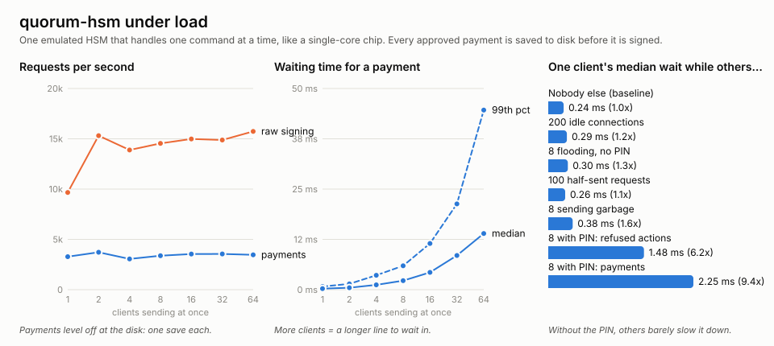

# Experiments: load and attacks

Two questions:

1. **How does the HSM behave when it's busy?** Many clients at once, people
   flooding it, a long steady load, and the process being killed in the
   middle of all that.
2. **What else could an attacker try?** Twenty more attacks, each one
   actually carried out, with the expected result written down first.

Everything here comes from one command, `./scripts/lab.sh` (about 3
minutes). The full numbers are in [`experiments/results.md`](experiments/results.md)
and the raw data in [`experiments/lab.tsv`](experiments/lab.tsv). The run
fails if any check fails or any attack ends differently from what was
expected, so these results are re-checked on every push (a short version
runs in CI).



*Measured on the emulator (a 4-core cloud machine, 2.1 GHz), which handles
one command at a time like a single-core chip. The board will be slower;
see [`HARDWARE.md`](HARDWARE.md).*

## Part 1: performance under load

### What we found

| Question | Answer |
|---|---|
| How many approved payments per second? | **About 3,300–3,700, however many clients there are.** Each one is saved to disk before it's signed, and the disk sets the pace. Signing without saving reaches ~15,000/s; reading a key's rules ~40,000/s. |
| What happens with more clients? | **They wait in line.** Throughput stays flat and waiting time grows with the queue: median 0.27 ms for 1 client, 2.3 ms for 8, 14 ms for 64 (99th percentile: 45 ms). |
| Is anyone starved? | **No.** With 64 clients, the slowest got 89% as much done as the fastest. |
| Are the counters still exact under contention? | **Yes.** 72,116 payments from up to 64 clients at once: the spending counter says exactly 72,116 cents, and every action number from 1 to 72,116 was handed out exactly once. |
| Does a long run drift? | **No.** 30 s at a steady 3,800–4,300 payments/s, 99th percentile 2.2–2.7 ms throughout; the state file stays 13,742 bytes. |
| Does killing the process mid-traffic lose anything? | **No.** 25 `kill -9`s during heavy traffic: every restart loaded the saved state; 12,034 signed payments reached clients and the HSM had counted 12,055. The 21 extra were saved, but the reply was lost in the crash. That's the safe direction: counted, never usable. No action number was ever handed out twice, and no client ever got a signature the HSM hadn't counted. |

### Noisy neighbours: who can slow the HSM down?

One ordinary client makes payments while others misbehave:

| What the others do | Ordinary client's median wait |
|---|---|
| nothing | 0.24 ms |
| 200 idle connections | 0.29 ms (1.2x) |
| 100 connections that send half a request and stall | 0.26 ms (1.1x) |
| 8 clients **without the PIN** flooding requests | 0.30 ms (1.3x) |
| 8 clients sending garbage | 0.38 ms (1.6x) |
| 8 clients **with the PIN** flooding refused actions | 1.48 ms (**6.2x**) |
| 8 clients **with the PIN** flooding approved payments | 2.25 ms (**9.4x**) |

**Someone without the PIN can barely slow the HSM down.** Requests that need
no PIN never touch the disk, and a half-sent request blocks nobody. Someone
**with** the PIN can slow everyone down about 6–9 times. A refused action
costs nearly as much as an approved one, because the refusal is written to
the audit log and saved first. The threat model already listed this risk;
now we have the number.

### Two things to improve

1. **The audit log is the first thing to give way under load.** The HSM
   holds 64 log entries and refuses to act when they're full (on purpose: it
   never drops evidence). With 16 or more busy clients, the audit collector's
   own requests wait in the same queue as everyone else's, the log fills
   between visits, and clients get "log full" and retry (8,500 retries at 64
   clients). Nothing is lost and the counters stay exact, but it's wasted
   work. Fixes: a bigger log buffer, letting the collector go first, or
   having the HSM stream the log out itself.
2. **Fairness between users.** The HSM serves whoever asks next, so one busy
   PIN holder delays everyone. Fixes: take turns between sessions, and limit
   how fast one session can be refused.

## Part 2: twenty more attacks

Expected outcomes, written down before running:
- **blocked**: the HSM refuses
- **stopped by the receiver**: the HSM signs, by design, and the shop's checks reject it
- **detected**: it happens, but leaves evidence that can't be hidden
- **works**: a known gap or a new finding

| # | Attack | Result |
|---:|---|---|
| 1 | Replay the user's approval for a second, identical payment | ✅ blocked (the one-time code is used up) |
| 2 | Move an approval to a different recipient | ✅ blocked |
| 3 | Use an approval for $21 on a $49 payment | ✅ blocked |
| 4 | Approve with the attacker's own "phone" key | ✅ blocked |
| 5 | Use an approval from one connection on another | ✅ blocked |
| 6 | Recipients that look like one thing but are another: a Cyrillic look-alike letter, a right-to-left override, a terminal escape code, a hidden NUL, a line break | ✅ blocked (all five) |
| 7 | Make the spending counter wrap around (1 cent, then the largest possible number) | ✅ blocked |
| 8 | Race: 20 connections spend the last of a $10 budget at the same instant (100 tries of $1) | ✅ blocked: exactly 10 approved |
| 9 | Reuse admins' approvals from an earlier change | ✅ blocked |
| 10 | Take approvals made for one HSM to another HSM with the same admins | ✅ blocked |
| 11 | Count one admin twice (same signature twice, or relabelled as another admin) | ✅ blocked |
| 12 | Delete log entries from the HSM before the collector copies them, **without the PIN** | 🔎 detected, not prevented |
| 13 | Guess the PIN, killing the HSM right after every attempt so it isn't counted | ✅ blocked: still locked after 5 |
| 14 | Learn the PIN from timing | ✅ blocked: no measurable difference (≤3 ns) |
| 15 | Use another connection's login | ✅ blocked |
| 16 | Present a payment with the wrong birth certificate (another key's, or one with old rules) | ✅ stopped by the receiver |
| 17 | Get two payments signed for the same one-time shop request | ✅ stopped by the receiver (the HSM signs both; the shop accepts one) |
| 18 | Random garbage, a request with one extra byte, a 4 GB length | ✅ blocked; the HSM keeps serving others |
| 19 | Fill the key store with ordinary keys (PIN only) so admins can't create agent keys | ❌ **works: new finding** |
| 20 | Roll back: copy the state file, spend the budget, put the old copy back | ❌ works: known gap |

**15 blocked, 2 stopped by the receiver, 1 detected, 2 work.** The full table,
with what happened in each, is in [`experiments/results.md`](experiments/results.md).

### What the attacks taught us

- **New finding (19): a PIN holder can block new agent keys.** The HSM has
  16 key slots shared by ordinary keys (PIN only) and agent keys (admins).
  Filling them with ordinary keys stops admins creating agent keys.
  Existing agent keys keep working, nothing is signed that shouldn't be,
  and the junk keys can be deleted again. Still, an ordinary user shouldn't
  be able to block the admins. **Fix:** reserve slots for agent keys, or
  require admin sign-off once ordinary keys pass a limit.
- **Known gap, now demonstrated (20): rollback.** Putting back an old copy
  of the state undoes spending. The emulator's file can be copied, and so
  can the board's external flash chip. Milestone 6 fixes this with a save
  counter in the chip's one-time memory.
- **Detected, not prevented (12): anyone can delete log entries from the HSM
  before they're collected.** Releasing log entries needs no PIN, so a
  collector can run without one. That means a program on the computer can
  release them first. The collector then sees the gap ("entries 4 to 4
  missing") and the signed checkpoint no longer matches, so it can't be
  hidden. But the details of what happened are gone. **Fix:** only release
  entries when shown a signed receipt from the collector, or require a
  collector key.
- **Our first timing test was itself wrong.** It reported a "leak": times rose
  steadily from 0 to 5 correct digits, about 34 ns in total. But it always
  tried the guesses in the same order, so it was measuring position in the
  round, not the PIN. With a fresh random order every round, the difference
  dropped to 0–3 ns, within the noise. The PIN comparison really is
  constant-time. Lesson: always randomise the order in timing measurements.
- **The HSM doesn't remember shops' one-time codes (17)**, by design: it has
  no room or clock to do it well, and the code is signed in, so the shop can
  refuse a second use. The experiment confirms the split works.

## How to run it

```bash
./scripts/lab.sh                      # everything (about 3 minutes)
target/release/quorum-lab attacks     # only the attacks (seconds)
target/release/quorum-lab load --seconds 5 --max-clients 128 --soak 120 --crash-rounds 100
```

The code is in `crates/bench/src/bin/quorum-lab/`: `load.rs` (load
experiments), `attacks.rs` (each attack, with its expected result) and
`common.rs` (starting HSMs in-process or as a process that can be killed).
